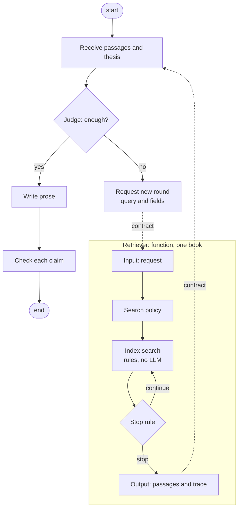

# Architecture

Status: proposed. The premises below are the basis for the split; the boundary's decisions are open in
`docs/contract_retriever_editorial.md` (D1 open; D2 accepted as a proposal; D3 accepted). Nothing here decides ingestion, which stays in `docs/ingest.md`.

## Shape

Two graphs, one boundary.

- **Editorial graph** (owned by the editorial AI, in this repo). It receives the passages and the thesis, judges
  whether the material is enough, and then either writes and checks the prose, or requests a new round with a query in
  text and closed fields.
- **Retriever function** (one book per call). It works on the index of one book, identified by its extraction version (`version_id`) and by the identities of its vectors and cut-off,
  and on the request it receives from the editorial AI. It does not receive the epub: ingestion has already turned the
  book into addressed paragraphs and an index. Inside the call it decides how to search and when to stop, and it
  returns text units with their addresses, plus a trace of what it did. The boundary is defined in the contract ledger;
  what the retriever delivers is described in `docs/retriever_requirements.md`.

## Premises

1. Each part does what it does best: the retriever runs rule-based search, deterministically; the editorial AI judges
   meaning, writes, and decides whether to ask again.
2. Adaptation inside a call does not depend on judgment. How the search adapts, and when it stops, are the retriever's
   decisions, taken from what the call itself provides.
3. Adaptation between rounds depends on the editorial AI, and it is explicit: only it decides the material is not
   enough, and that reaches the retriever as a request with declared content.
4. Repeatability and caching require that search depends only on declared inputs. The retriever keeps no state between
   calls; anything it needs from an earlier round arrives in the request.
5. The boundary is a written contract, defined in the contract ledger.
6. There is no second judge. Judgment of meaning belongs to the editorial AI, and the tools it uses for that are part
   of its role.
7. The editorial graph lives in this repository together with the retriever.

## Warning

The earlier single graph, which mixed search, judgment and composition, coupled its parts: a change in one could alter
what another saw, and the coupling was hard to see from inside the graph. This is a caution for the new design, drawn
from that experience, not a measured result. Keep each part's inputs declared, so that a change in one part shows up at
the boundary rather than inside another part.

## Boundary

- Only the block's question, or variants the retriever derives from it by its rules, or the query the editorial AI sends
  in a new round, is searched as text. The rest of the request is not a query.
- The boundary carries a request in and a result out. Their contents are defined in `docs/contract_retriever_editorial.md`.
- The extraction version (`version_id`) identifies the text the passages come from. The index is identified by that
  version together with its vector and cut-off identities (see `docs/ingest.md`, D10).

## Open

- D1: the next-round request is hybrid, a query in text plus closed fields. Proposed in the contract ledger; the exact
  specification of the fields is open.

Settled since the first draft: the output unit is the paragraph, with neighbours by address on request (D2, accepted as a
proposal). The retriever contains no language model; the embedding model that vectorizes queries is part of the search.
