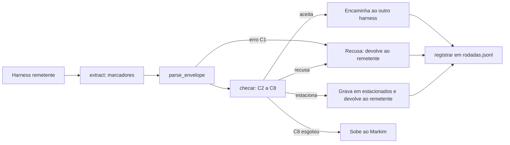

# Proposta: contrato curto e gate mecânico para o modo CRITIQUE

**Status:** proposta. Decisões D1 a D5 registradas. Os pipelines A e B e o `driver.py` foram removidos; as menções a eles abaixo são histórico. O pipeline oficial é o mod (D5).
**Escopo:** o que cada harness recebe (contrato), o que o gate confere antes de encaminhar, e onde ele roda em cada pipeline.
**Não altera:** `CLAUDE.md`, `docs/modo_critique.md`, `docs/auto_critique/*`, `tools/auto_critique/*`. Cada mudança nesses arquivos é uma etapa própria, depois da aprovação.
**Custo de API previsto:** 0 chamadas. Esta proposta é texto; nenhuma execução paga.

---

## 1. Premissas e decisões de base

Cada item abaixo tem o que o torna necessário e o que o invalidaria.

- **P1. Existem três pipelines de troca, e nenhum é o único caminho.**
  Necessária porque: o laço tem uma via pela API (`api_loop.py`) e duas vias de clipboard pelo Hammerspoon (seção 6.1).
  Invalidada por: a escolha de um pipeline oficial único, ou a cópia manual virar rotina. Nesse caso o gate só precisa estar nesse pipeline.

- **P2. O lado Claude do laço roda sem `CLAUDE.md` e sem hooks do projeto.**
  Necessária porque: `driver.py` chama `claude -p` com `cwd` em `/private/tmp/critique_cli_work`.
  Invalidada pela decisão D1 = B (seção 7): o `cwd` passa a ser o repo.

- **P3. O gate confere forma, não sentido.**
  Necessária porque: script não julga se um critério está cumprido. Essa parte continua com o harness, que a relata.
  Invalidada por: um critério passar a ser verificável por máquina (ex.: "o trecho existe no material"). Esse critério sai do juízo e entra na porta.

- **P4. O entregável e a árvore de nós são escritos pelo Markim, não pelos harnesses.**
  Necessária porque: se um harness escreve o critério, ele molda o entregável pelo próprio interesse.
  Invalidada por: uma rodada em que o Markim delega a escrita da árvore explicitamente.

- **P5. Os critérios de aceite têm identificador estável.**
  Necessária porque: o gate confere "o critério citado existe na árvore" por identificador, sem ler texto.
  Invalidada por: critérios que mudam de texto sem mudar de id. Nesse caso o id perde a função.

- **P6. Cada arquivo tem um só escritor.**
  Necessária porque: dois escritores no mesmo arquivo reproduzem o problema que o design de memória já resolveu (P1 de `harness_memory_design.md`).
  Invalidada por: um arquivo que precise de dois escritores. Nesse caso ele é dividido em dois.

## 2. Contrato curto (proposta de texto para `CLAUDE.md`, ainda não aplicado)

> **Modo CRITIQUE.** Cada mensagem entre harnesses começa com o envelope definido em `docs/proposta_gate_critique.md`, seção 3.
> Trabalhe só no nó indicado em `alvo`. Melhoria só entra na rodada se citar um `criterio` existente.
> Não altere o brief nem o arquivo de estado da rodada.
> Entregue a resposta entre `<<<MSG` e `MSG>>>`, sem texto fora dos marcadores.

Quatro linhas. O resto da proposta é mecânica para o gate, não instrução para o harness. Isso segue a regra de que instrução orienta e porta recusa.

## 3. Envelope da mensagem

Usa os marcadores que `driver.py` já extrai (`<<<MSG` e `MSG>>>`). O cabeçalho vem antes de uma linha `---`:

```
<<<MSG
brief: docs/ingest.md sha256:<64 hex>
alvo: N2
criterio: N2.c1
pedido: <uma pergunta ou uma ação>
material: <id do trecho do entregável>
---
<corpo da mensagem, com o campo de saída da seção 5>
MSG>>>
```

Campos:

| Campo | Regra |
|---|---|
| `brief` | caminho e sha256 do arquivo que define a tarefa, o entregável e os critérios |
| `alvo` | id de um nó da árvore |
| `criterio` | id de um critério desse nó (obrigatório para crítica; para pergunta, usar `-`) |
| `pedido` | uma pergunta ou uma ação. Duas perguntas são duas mensagens |
| `material` | id de um trecho do entregável em revisão (`-` se não há trecho) |

O número da rodada não vem da mensagem. O gate o deriva do histórico (seção 6.3). Assim o harness não pode errar nem fraudar o número.

## 4. Arquivo de estado da rodada

Caminho: `tools/auto_critique/estado.json`. Versionado no git, como registro da árvore que cada rodada recebeu. Quem edita não está restrito por regra (D4 revogada). O conteúdo atual é um placeholder, que existe só para destravar o caminho do gate.

```json
{
  "brief": { "path": "docs/ingest.md", "sha256": "<64 hex>" },
  "orcamento_rodadas": 6,
  "sem_mudanca_limite": 2,
  "nos": [
    {
      "id": "N1",
      "ordem": 1,
      "aberto": false,
      "criterios": [
        { "id": "N1.c1", "descricao": "..." }
      ]
    },
    {
      "id": "N2",
      "ordem": 2,
      "aberto": true,
      "criterios": [
        { "id": "N2.c1", "descricao": "..." }
      ]
    }
  ]
}
```

- `nos` é uma lista ordenada. A ordem é decidida pelo Markim (dependência primeiro, depois risco).
- `aberto` é o campo que o gate lê para decidir o alvo. Quem fecha um nó é o Markim, depois de conferir o critério.
- `rodada_atual`, `sem_mudanca_consecutivas` e `estacionados` saíram deste arquivo. Os dois primeiros são derivados do histórico; o último vive em `estacionados.jsonl` (seção 6.3). Assim o `estado.json` tem um só escritor.

## 5. Checagens do gate

Ordem de execução. Cada check tem uma saída fixa.

| # | Check | Tipo | Se falhar |
|---|---|---|---|
| C1 | Envelope completo, campos na ordem da seção 3 | forma | recusa: devolve motivo ao remetente |
| C2 | `sha256` do brief é igual ao do arquivo | forma | recusa: o brief mudou; o Markim atualiza o estado |
| C3 | `alvo` = primeiro nó com `aberto: true` | forma | estaciona: não encaminha; devolve ao remetente |
| C4 | Um único `pedido` | forma | recusa |
| C5 | `criterio` existe no nó `alvo`. Crítica sem `criterio` vai para estacionados | forma | estaciona |
| C6 | `material` existe no entregável (busca por id) | forma | recusa |
| C7 | Campo `estado do entregável` presente no corpo | forma | recusa |
| C8 | Orçamento não esgotado e `inalterado` consecutivos < `sem_mudanca_limite` | forma | fecha a rodada e sobe ao Markim |

**Suspensas nesta etapa:** C6 (material existe), C7 (campo de estado declarado) e C8 (orçamento e convergência) saíram da implementação. As regras delas ainda são suposição, e voltam ao desenho depois de testes reais. Enquanto isso, o `estado.json` pode manter `materiais`, mas o gate não o usa. Sem C8, o laço para só por limite de envios, timeout, recusas seguidas, C3 sem nó aberto e erro do gate.

**Não é checado pelo gate** (juízo, relatado no corpo da mensagem): se o critério está cumprido, se o argumento é bom, se o trecho sustenta a afirmação.

**Campo de saída que todo harness preenche no corpo**, para o gate e para o Markim:

```
estado do entregável: alterado | inalterado
criterio: <id> cumprido: sim | não | parcial
```

`inalterado` conta para a sequência do C8. Uma rodada com `alterado` zera a sequência.

Renumeração em relação à versão anterior: o antigo C3 (número da rodada) saiu, porque a rodada é derivada (seção 6.3). A numeração das demais checagens mudou para seguir a ordem de execução.

## 6. Arquitetura de implementação

### 6.1 Pontos de passagem reais

Há três pipelines de troca. Confirmei os três pelos arquivos do repo.

| Pipeline | Lado Claude | Lado dsh | Onde o texto cruza |
|---|---|---|---|
| A. API (`api_loop.py`) | `driver.py`, que chama `claude -p` com sessão única | `session/prompt` para enviar e `session/page` para ler | `driver.py` grava `OUT_FILE`; `api_loop.py` envia ao dsh e lê a resposta |
| B. CLI + Hammerspoon (`laco_cli_hammerspoon.lua`) | `driver.py` | colagem na interface do dsh, por clipboard | `OUT_FILE` (Claude→dsh); arquivo de resposta do dsh (dsh→Claude) |
| C. App + Hammerspoon (`laco_hammerspoon.lua`) | sessão do app, capturada pelo hook `Stop` (`cc_stop_forward.sh`) | colagem na interface do dsh, por clipboard | `/tmp/cc_last_answer.txt` (Claude→dsh); clipboard (dsh→Claude) |

Além disso, `dsh_step.py` (ponte do mod) importa `api_loop`. Não confirmei onde `register.ts` o usa: o grep por `dsh_step` no `register.ts` não encontrou nada.

Consequência: não existe um ponto único. Para A e B, `driver.py` é comum no lado Claude. Para C, nada é comum com A ou B.

### 6.2 Módulo do gate

`tools/auto_critique/gate.py`, com duas faces:

- **Módulo importável**, para o pipeline A e o `dsh_step.py`.
- **CLI**, para os pipelines que não são Python (Lua e o hook de shell):
  `gate.py check --direcao claude-para-dsh|dsh-para-claude`. Lê a mensagem em stdin e devolve JSON em stdout. Código de saída 0 = aceita; 2 = recusa ou estaciona.

Componentes:

- `parse_envelope(texto) -> Envelope | ErroForma`
- `carregar_estado(caminho) -> Estado`: confere o sha256 do brief e falha se divergir.
- `checar(envelope, estado, historico) -> Veredito`. Função pura. Veredito: `Aceita` | `Recusa(check, motivo)` | `Estaciona(check, motivo)` | `Encerra(motivo)`.
- `registrar(envelope, veredito, direcao)`: anexa uma linha a `rodadas.jsonl`. Se estacionar, anexa também a `estacionados.jsonl`.

Só `carregar_estado` e `registrar` fazem I/O. `checar` recebe tudo pronto, o que permite testá-la sem arquivos nem API.

### 6.3 Escritores: um por arquivo

| Arquivo | Escritor | Conteúdo |
|---|---|---|
| `tools/auto_critique/estado.json` | sem restrição (D4 revogada) | brief, orçamento, sem-mudança, árvore com `aberto`, `materiais` |
| `docs/critique/rodadas.jsonl` | só `gate.py` | uma linha por mensagem aceita ou recusada: rodada, direção, veredito, `estado do entregável` |
| `docs/critique/estacionados.jsonl` | só `gate.py` | um item por estacionado: id, origem, motivo, rodada |

Derivações, sem escrita extra:

- **Número da rodada:** última linha de `rodadas.jsonl` + 1, começando em 1. Usado pelo C8 e pela devolução.
- **Sequência `inalterado`:** contagem de linhas `inalterado` desde a última `alterado`. Usada pelo C8.
- **Orçamento:** número de linhas de `rodadas.jsonl` contando só as aceitas. Recusas e estacionamentos não gastam orçamento.

### 6.4 Fluxo



### 6.5 Onde o gate roda em cada pipeline

- **A (API):** o gate entra no `driver.py`, antes de gravar `OUT_FILE`, para o sentido Claude→dsh. Isso cobre o `api_loop.py` sem mexer nele. Para o sentido dsh→Claude, o gate entra em `api_loop.main`, depois de `wait_reply` e antes de `claude_in = reply`.
- **B (CLI + Hammerspoon):** mesmo ponto no `driver.py` para Claude→dsh. Para dsh→Claude, o gate precisa rodar antes de o Lua gravar o arquivo de semente. Ponto a confirmar no `laco_cli_hammerspoon.lua`.
- **C (App):** o gate entra no `cc_stop_forward.sh`, que já lê `last_assistant_message`. Bloquear o `Stop` com motivo depende de confirmação (seção 9). Para dsh→Claude não há ponto de entrada no app: a colagem é manual pelo Hammerspoon. Esse pipeline fica de fora do gate até uma decisão.

### 6.5a Pipeline oficial: o mod (D5)

O mod roda no app. Os pontos de passagem são estes:

- **Claude → dsh:** `register.ts`, no `turn.complete`, antes de `dsh_step.py send`. Hoje o hook envia direto; o gate entra entre a resposta do Claude e o envio.
- **dsh → Claude:** `register.ts`, no temporizador, depois de `dsh_step.py read` e antes de `$.prompt.submit`.
- **Gate:** `gate.py` chamado por `$.process.run`, como os demais comandos do mod. A regra de devolução (D3) vale para os dois sentidos: o motivo volta ao remetente, por `$.prompt.submit` quando é o Claude, e por `dsh_step.py send` quando é o dsh.
- **Estado:** `estado.json` fica em `tools/auto_critique/`, e `rodadas.jsonl` e `estacionados.jsonl` ficam em `docs/critique/`. Todos estão fora do mod, e são lidos pelo gate.

Pendência de desenho: o `dsh_step.py` hoje lê o token e o cookie de `/private/tmp/critique_cli_work`. O gate não depende desses arquivos.

### 6.6 Devolução ao remetente

A mensagem de devolução é gerada pelo gate. Ela não passa pelo gate e não conta como rodada nem como orçamento. Isso evita um laço de recusa sobre recusa.

**Premissa nova, sem decisão ainda:** quantas recusas seguidas um laço aceita antes de parar. O D2 conta rodadas, não recusas. Sem esse limite, um harness que erra o envelope sempre pode girar sem fim. Proposta para decidir depois: 3 recusas seguidas no mesmo par de mensagens param o laço e sobem ao Markim.

### 6.7 Contrato do lado dsh

Hoje só o lado Claude recebe instrução de formato. O `driver.py` põe o `INSTRUCAO` (pedindo `<<<MSG ... MSG>>>`) antes de cada prompt. Essa é a camada "por turno" que já existe, no lado Claude dos pipelines A e B.

O dsh não recebe esse prefixo. Para seguir o contrato, o texto precisa estar no `CLAUDE.md` (o dsh lê o arquivo, pelo P25 de `harness_memory_design.md`). O gate também precisa aplicar `extract()` à resposta do dsh, porque hoje só o lado Claude usa extração.

## 7. Decisões do Markim

Cada decisão tem um default. O default vale até o Markim escolher outro.

- **D1. Onde roda o driver do lado Claude. Decidida: B.**
  Decisão do Markim: o driver roda com `cwd` fixo no repo, e a sessão do laço começa nova na troca.
  Efeitos aceitos: o `CLAUDE.md` do repo e a memória do projeto entram em cada chamada do lado Claude; o conteúdo da memória pode sair para o dsh, que usa o provedor `deepseek-official`; a troca exige sessão nova, porque as sessões ficam por diretório de trabalho.
  Requisito de implementação: o caminho do repo é constante no driver, não o `cwd` de quem chama. O `api_loop.py` herda o diretório de execução do Python.
  Premissa P2 invalidada por esta decisão.
  Implementação ainda não feita: fica para a etapa 4 da seção 10, depois de D4.

- **D2. Limite de rodadas e de rodadas sem mudança. Decidida: default.**
  Decisão do Markim: `orcamento_rodadas` = 6, `sem_mudanca_limite` = 2. Valores pequenos de propósito: ao esgotar, o assunto sobe ao Markim.
  Invalidada por: um entregável que precise de mais rodadas para convergir. Revisar com a primeira rodada real.

- **D3. O que acontece com itens estacionados. Decidida: default.**
  Decisão do Markim: devolvidos ao remetente com o motivo; não encaminhados ao outro harness; gravados em `estacionados.jsonl`. Decisão tomada como comportamental, revisável depois.
  Invalidada por: um estacionado que o Markim queira ver antes de voltar ao remetente.

- **D4. Estado da rodada. Revisada.**
  Decisão do Markim: o `estado.json` fica versionado em `tools/auto_critique/`. A regra anterior, de que só o Markim edita o arquivo, foi removida.
  Premissa: o arquivo é o registro da árvore dada a cada rodada. O conteúdo atual é um placeholder.
  Invalidada por: a necessidade de restringir a escrita, se um harness começar a alterar a árvore.
  Invalidada por: a necessidade de automatizar a abertura de cada rodada. Nesse caso o script é um escritor único, e o Markim continua aprovando.

- **D5. Qual pipeline é oficial. Decidida: mod.**
  Decisão do Markim: o pipeline oficial é o plugin no app, com o dsh pela API via `dsh_step.py`. Os pipelines B e C ficam fora do gate.
  Premissa: o teste de `start 2` com o mod validou o caminho (4 chamadas, conciliadas na seção 10).
  Invalidada por: a volta do uso do `api_loop.py` como programa independente, ou do clipboard como transporte.

## 8. Plano de verificação (quando for implementado)

Nenhuma parte roda com API. Cada check tem um teste de unidade com envelopes de exemplo:

- um envelope válido e um caso de falha para cada C1–C8;
- estado com `alvo` diferente do primeiro aberto (C3 deve estacionar);
- brief com sha256 errado (C2 deve recusar);
- histórico com `inalterado` até o limite (C8 deve encerrar);
- mensagem de devolução que não entra no histórico como rodada.

Os testes podem seguir o padrão de `tools/auto_critique/test_extract.py` (`unittest discover -s tools`). O gate só é dado como validado quando todas as checagens passarem nesses testes. Depois, uma rodada de laço de teste com uma mensagem de cada tipo (aceita, recusada, estacionada). Essa rodada de teste conta chamadas de API antes de ser feita.

## 9. Não verificado e referências quebradas

- **Stop hook do Claude Code:** não confirmado se um bloqueio no `Stop` devolve o motivo ao modelo. O skill documenta `decision: "block"` como aplicável a `Stop`, mas só explicita o retorno ao modelo para `PostToolUse`.
- **UserPromptSubmit:** o skill não documenta o nome do campo de entrada com o prompt.
- **Registro do `cc_stop_forward.sh`:** não localizado. Não aparece em `.claude/settings.local.json`. Provavelmente fica no mod (`hooks/hooks.json`), não lido.
- **Uso do `dsh_step.py` pelo mod:** não confirmado. O `register.ts` não menciona o arquivo.
- **Referência quebrada:** `docs/modo_critique.md` (linha 35) e `CLAUDE.md` apontam para `docs/auto_critique2.md`, que não existe. A documentação do laço pode estar em `docs/auto_critique/auto_critique.md`. Corrigir a referência é uma etapa separada, fora desta proposta.
- **Desenho já existente:** `docs/auto_critique/discovery.md` tem envelope, árvore, estacionados e pergunta de deriva. Esta proposta implementa esse desenho na forma de checagens; ela não o substitui.
- **Memória do dsh:** o `harness_memory_design.md` é a referência para o que o dsh carrega. Não foi relido nesta proposta.

## 10. Próximos passos (cada um só depois de aprovação)

1. Decisões D1 a D5 registradas. Próximo: os passos 2 a 6.
2. Corrigir a referência quebrada a `auto_critique2.md`.
3. Aplicar o trecho da seção 2 em `CLAUDE.md`, copiado literal da seção, sem reescrever.
4. Implementar as checagens C1–C8 e o histórico como funções puras com testes (seção 8). Incluir o driver com cwd fixo (D1).
5. Ligar o gate ao mod (`register.ts` e `dsh_step.py`), como descrito na seção 6.5a.
6. Rodada de teste com contagem prévia de chamadas.
